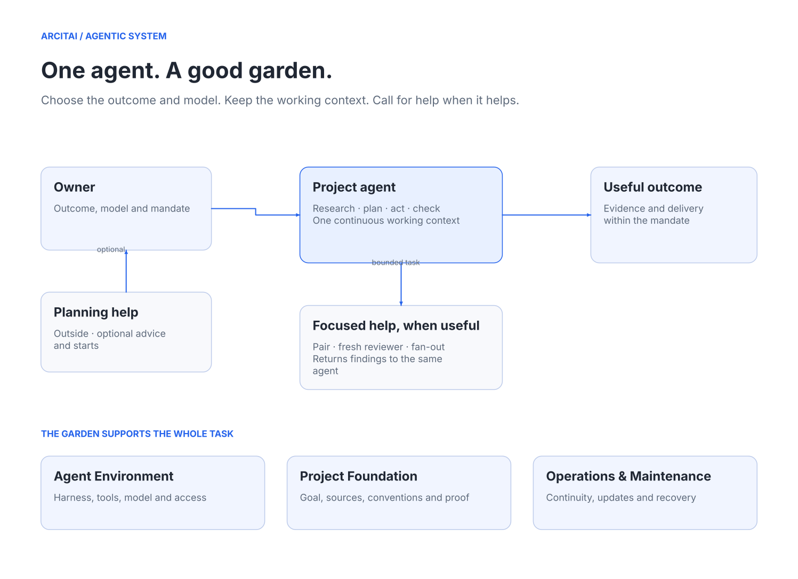

# Agentic System

Revision: 0.2.1 · Updated: 2026-11-14

Build a good environment for capable agents to do useful work.

Agentic System is an open framework for the foundation, boundaries and ongoing care around agent work. Choose a model and an outcome. One project agent normally researches, plans, acts, checks and follows the work through. It can call a pair, a fresh reviewer or parallel helpers when useful. A separate internal manager or a fixed chain of specialist agents is not required.

Use it for software, research, BI, defence and other work. Each project keeps its own purpose, context, selected methods and native tools.

The Lab adopted released **0.2.0** on T3 Stable **0.1.9**, retaining the same
conversation and access boundaries. Its installed methods were discovered and used;
a repaired instruction route was followed after a manual server reload. This is
bounded assisted proof, not unattended operation. See [qualification](docs/qualification.md)
and [remaining work](docs/backlog.md).

## The garden

| Area | What it prepares and maintains |
| --- | --- |
| **Agent Environment** | Harness, models, tools, workspace, identities, credentials and enforced access |
| **Project Foundation** | Goal, authoritative sources, relevant knowledge, conventions, mandate and useful checks |
| **Operations & Maintenance** | Continuity, updates, failure signals, recovery and the care the work needs |

These are responsibilities, not three compulsory machines or onboarding phases. Prepare what the intended work needs and reuse unchanged proof.

## Use it

1. Give your normal assistant a clear outcome and choose the model. The optional `agentic-entry` skill can explain this framework or find the relevant project routes.
2. Use `agentic-foundation` directly when setup, adoption or operating conditions need attention. Keep a thin project bootstrap and load relevant references only.
3. Let the project agent complete the accepted work with the project's selected methods. Use additional agents when their contribution justifies the handoff. Existing project review and delivery requirements still apply.

A clear owner request can already admit work and delegate delivery; no separate acceptance form is required. A skill, issue or model verdict cannot grant missing access. Human decisions are requested where the mandate requires them, not at every phase boundary.

## Methods, sources and library

The [Notion guide](https://www.notion.so/4046d2e17f568159a603de2dd6b91c2a) authors the general method. This repository provides reviewed, portable distributions and Lab technical records. Follow the selected version; do not silently refresh a running task from another edition. See [source ownership](docs/system-definition.md).

| Skill | Use |
| --- | --- |
| `agentic-entry` | Optional outside entry: understand the framework, locate a project, help with authorized native starts or status |
| `agentic-foundation` | Prepare, assess or repair the environment, project foundation and operations |
| `agentic-evaluate` | Compare models, methods or setups when evidence can change a decision |
| `agentic-security` | Optional defence method for a bounded, authorized security question |

The [Reference library](https://www.notion.so/4176d2e17f568129ab71cfa0b2aecbd8) holds selectable sources, including Google Chrome's Modern Web Guidance for web project foundations. A library entry is not an installation or an automatic dependency. Select the relevant guidance in the project's own context.

A **work module** is the methods, checks and domain knowledge selected for the work. Software projects use their own sufficient native or specialist methods; OSM is optional. The former ADLC stage skills and AgentOps role are retained in [0.1.34 history](https://github.com/arcitai/agentic-system/tree/v0.1.34), outside the active distribution.

## Architecture



The [architecture guide](docs/architecture.md) separates workflow, responsibilities and actual deployment. Fresh context and worktrees are not credential boundaries. Preserve the native broker, OS, service and environment controls that enforce a project's allowed access.

## Portable distribution

Clone a reviewed release, then stage the selected methods into a new directory:

```sh
python3 scripts/stage.py all --output /path/to/new-stage
```

Staging copies the selected skills and their resources; it does not install them. Inspect its manifest and use Foundation's adoption guidance before changing an installation. The skills work without this checkout or live Notion access. Follow [CONTRIBUTING.md](CONTRIBUTING.md) for checks, source exports and releases.

## Agentic System Lab

Lab remains one project in T3 Code on Z13. It investigates the method and concrete open questions. Product development for OSM, Bridge and OpenPaperDesign continues in its own Codex projects, outside Lab.

T3 Code **Beta** is the desktop product label; **stable** is its selected release channel. Installation and native qualification are separate from this source revision. Read the dated [Lab qualification record](docs/qualification.md) and [current backlog](docs/backlog.md); a new method release does not clear an operational hold or enable intake.

The repository was renamed from `arcitai/factory`, then `arcitai/agentic-systems`; its identity, commits, issues and historical releases are preserved. The old names remain in dated evidence.

MIT covers the method, code and documentation. Arc’ It AI branding has [separate terms](assets/branding/README.md). Inspired by the [Warp Factory Stack](https://www.warp.dev/blog/the-factory-stack), [harness engineering](https://openai.com/index/harness-engineering/) and the sources in the reference library; this is an independent framework, not a Warp-compatible runtime.
