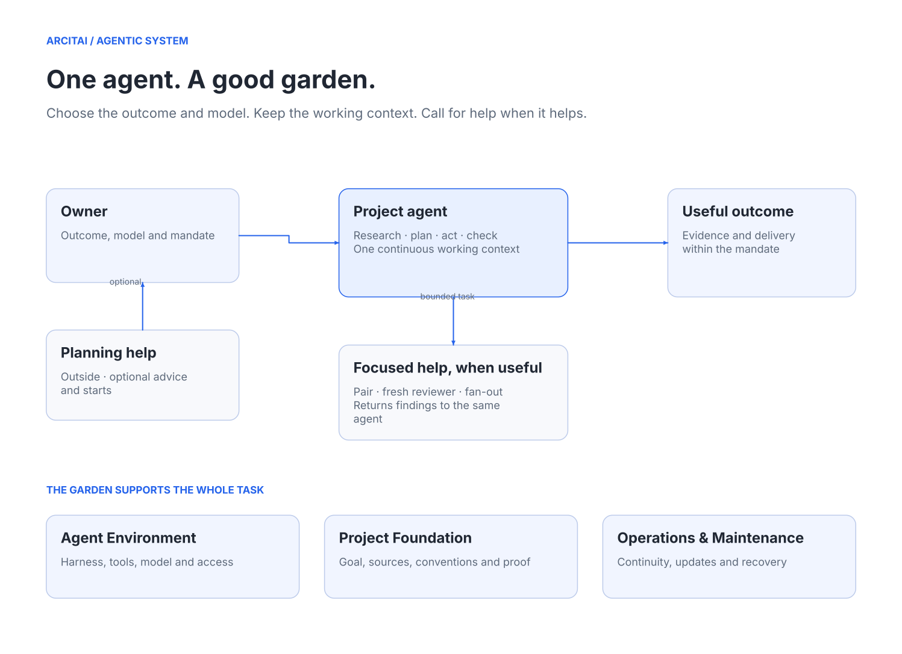

# Agentic System


Revision: 0.2.3 · Updated: 2026-11-26

Prepare useful working ground for AI: a clear outcome, reliable context, suitable tools and a way to judge the result.

Agentic System is an open framework with guidance, reusable methods and project templates. Use it for research, BI, content, software and other work. Start in the tools you already use and prepare what the next task needs.

## Why the foundation matters

A person or agent arriving at a project needs to find the relevant sources, understand what it may change and recognize a useful result. Keeping that ground clear reduces repeated explanation and makes it easier to continue after a break.

| Area | What it prepares and maintains |
| --- | --- |
| **Agent Environment** | Where the agent works: its model, tools, files and permitted access |
| **Project Foundation** | The outcome, trusted sources, working context, mandate and meaningful checks |
| **Operations & Maintenance** | Continuity, updates, recovery and the ongoing care the work needs |

A small project can cover these in one existing brief or workspace. Add detail when the work needs it.

## Start with one useful task

1. Choose an outcome and model, or explicitly delegate that choice.
2. Put the relevant context, sources, authority and checks where the project agent can find them. Adapt the optional [project brief](templates/project-brief.md), or use the project record you already have.
3. Ask the agent to carry the task through to a checked result. It can bring in a fresh reviewer, a pair or temporary helpers when useful. Existing project review and delivery rules still apply.

For example, a research task might compare three selected sources and produce a one-page recommendation. The brief identifies the question, source routes, intended reader and what evidence should support the recommendation. The same approach can support a content draft, a KPI check or a small software change.



A clear owner request can already admit work and delegate delivery. Native tools enforce access; the project's instructions record how that access may be used.

## Explore

The [Notion guide](https://www.notion.so/4046d2e17f568159a603de2dd6b91c2a) is the human entry to the current shared method. It explains setup, context, useful work and ongoing care, and links to the current Skills library.

| Find | Start here |
| --- | --- |
| A small definition for your project | [Project brief](templates/project-brief.md) |
| Workflow, responsibilities and execution boundaries | [Architecture](docs/architecture.md) |
| Current authoring and versioned export choices | [Definition and source ownership](docs/system-definition.md) |
| Domain guidance and further reading | [Reference library](https://www.notion.so/4176d2e17f568129ab71cfa0b2aecbd8) |
| Changes to this framework | [Contributing](CONTRIBUTING.md) |

OSM can provide shared business Data and Context when that helps a project. Agentic System prepares the project's working conditions; each project chooses its own context home and methods.

## Choose a method source

The current Notion authoring library has six cross-domain Core methods: Foundation, Brief, Council, Takeover, Full Stop and Output. It also offers the optional Software method New Feature. Read the relevant current method when the project has selected that live source, record the version used and handle changes affecting ongoing work explicitly.

This repository's **0.2 portable line** deliberately retains earlier selected exports:

| Portable method | Use |
| --- | --- |
| `agentic-entry` | Optional help understanding the framework, locating a project or checking status |
| `agentic-foundation` | Prepare, assess or maintain the project's working ground |
| `agentic-evaluate` | Compare alternatives when evidence can change a decision |
| `agentic-security` | Optional method for a bounded, authorized defensive question |

These exports are a separate versioned choice from the live six-method Core. Read their own version metadata and [source record](docs/system-definition.md); this documentation release does not replace them with the later authoring edition. Existing installations keep their selected versions until deliberately adopted.

### Install or connect Agentic System

Choose the distribution channel that matches your agent app. All channels serve the exact same reviewed GitHub files with zero login and zero customer data:

| Option | What it provides | When to use it |
| --- | --- | --- |
| **Native plugin** | Local plugin install for Claude Code (canonical skill folders), Codex (local zero-dependency stdio MCP), or Cursor | Best default for Claude Code, Codex, and Cursor |
| **Public MCP server** (`https://mcp-agentic-systems.arcitai.com/mcp`) | Read-only, login-free HTTP MCP server with every portable method, `templates/project-brief.md`, and docs (pin with `/v0.2.3/mcp`) | Best fit for OpenBot, Grok Bot, T3 Code, or any MCP client without copying files locally |
| **Staged copy** (`scripts/stage.py`) | Flat local copy with a SHA-256 `manifest.json` | Best when a project wants a frozen, reviewed local copy inside a workspace |

For **Claude Code**:

```sh
claude plugin marketplace add arcitai/agentic-system
claude plugin install agentic-system@arcitai --scope user
```

For **Codex**:

```sh
codex plugin marketplace add arcitai/agentic-system
codex plugin add agentic-system@arcitai
```

For **any MCP client** (OpenBot, Grok Bot, T3 Code, Codex, Claude Code, or Cursor; see [apps/mcp/README.md](apps/mcp/README.md)):

- Latest release: `https://mcp-agentic-systems.arcitai.com/mcp`
- Pinned release: `https://mcp-agentic-systems.arcitai.com/v0.2.3/mcp`
- Health and SHA-256 verification: `https://mcp-agentic-systems.arcitai.com/health`

To stage these portable methods from a reviewed release into a new directory:

```sh
python3 scripts/stage.py all --output /path/to/new-stage
```

Staging copies the selected methods and resources. Follow Foundation's adoption guidance before changing an installation. The staged methods remain usable without this checkout or live Notion access. The optional project brief is a separate document in the repository/source archive, not a runtime dependency of a staged skill.

## Learn, adapt and share

A work module is the methods, checks and domain knowledge selected for the work. Use the [Reference library](https://www.notion.so/4176d2e17f568129ab71cfa0b2aecbd8) to find relevant starting points and keep project-specific choices with that project. Share a useful example or propose an improvement through this repository.

Agentic System Lab is one project using the framework. Its dated [qualification](docs/qualification.md) and [remaining work](docs/backlog.md) describe that installation, its results and holds. They are separate from this framework's general setup guidance. The retained [Lab 0.9 declaration](system.yaml) is a dated example, not a generic project starter or fresh installation evidence.

The former software-stage methods and AgentOps arrangement remain in [0.1.34 history](https://github.com/arcitai/agentic-system/tree/v0.1.34). The repository's earlier names, `arcitai/factory` and `arcitai/agentic-systems`, remain in dated records and releases.

MIT covers the method, code and documentation. Arc’ It AI branding has [separate terms](assets/branding/README.md). Inspired by the [Warp Factory Stack](https://www.warp.dev/blog/the-factory-stack), [harness engineering](https://openai.com/index/harness-engineering/) and the sources in the Reference library; this is an independent framework.
