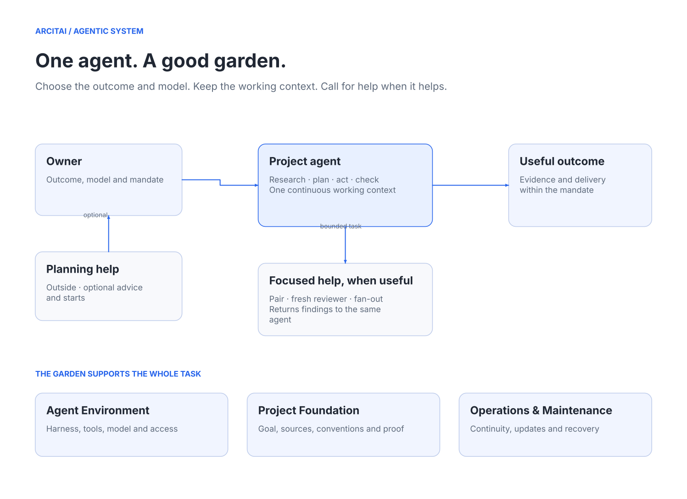
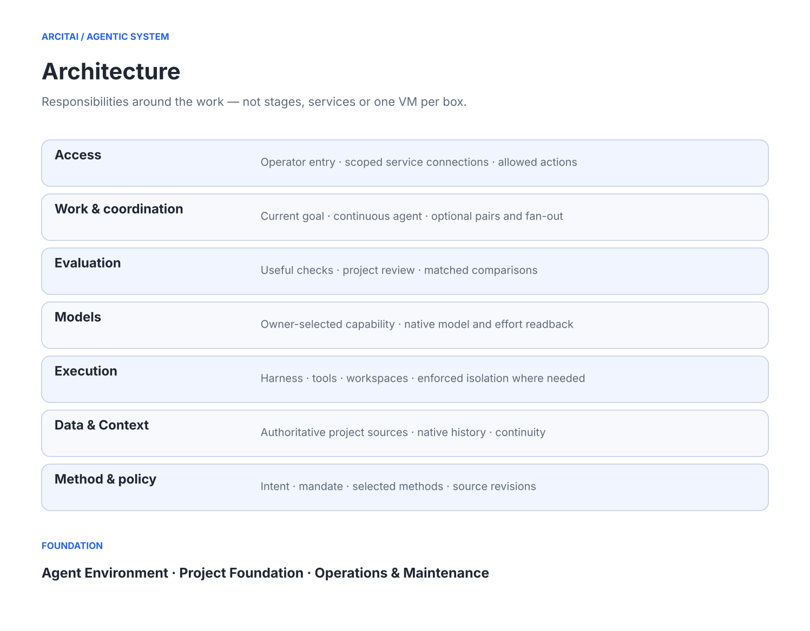
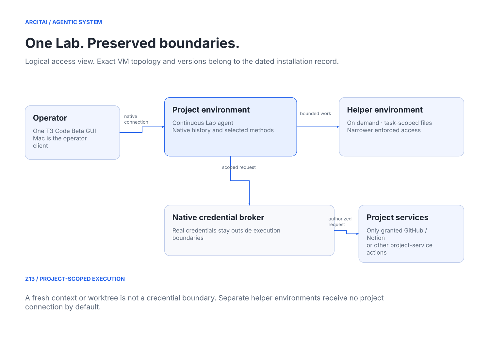

# Architecture

Revision: 0.2.0 · Updated: 2026-11-13

Agentic System is the garden around agent-led work. Keep workflow, responsibility and deployment views distinct.

## Work

The owner sets the outcome and chooses the model, or explicitly delegates a choice. One project agent normally retains the task through research, planning, action, verification and authorized delivery. It may use focused pairs, fresh reviewers or fan-out. These are useful calls, not required handoffs. Existing project policies can require specific review.

Optional outside planning help assists the owner with ideas, priorities, model choices and native starts. The project agent retains the actual work; no permanent internal AgentOps manager or extra model-selection agent is prescribed. A skill is a procedure the same agent may use, not a separate agent role.

## Responsibilities

| Area | Responsibility |
| --- | --- |
| Access | Human/operator entry, service connections and allowed actions |
| Work & coordination | Current goal, continuous work and useful conditional helpers |
| Evaluation | Relevant checks, review and decision-oriented comparisons |
| Models | Owner-selected capability and actual native model/effort readback |
| Execution | Harness, tools, task workspaces and enforced isolation where required |
| Data & Context | Authoritative project sources, native history and necessary continuity |
| Method & policy | Project intent, mandate, selected methods, constraints and source revisions |

The layers are responsibilities, not a sequence, seven services, seven agents or seven VMs. Foundation prepares Agent Environment, Project Foundation and Operations & Maintenance across these responsibilities. A small project may need little setup in each.

## Native boundaries

Lab runs as an isolated project environment on Z13 with a native T3 operator connection. One persistent working conversation retains history. Helpers can use narrower, separately enforced execution boundaries when their task requires them. Their lifecycle is a native capability, not another permanent coordinator LLM.

Credentials remain outside the execution boundary when a broker is required. The project agent retains only its authorized project-service reach; helpers receive selected context and appropriate access. Processes in one environment may share that environment's brokered reach. Fresh contexts, worktrees, names and role instructions do not create an identity or credential boundary.

The workflow change itself neither grants nor removes access, changes network rules nor collapses isolated helpers into a shared environment. Method edits, installation changes, reviews and delivery remain governed by their existing authority. Canonical common-method changes require a concrete owner decision or delegation.

## Source and implementation

The [public guide](https://www.notion.so/4046d2e17f568159a603de2dd6b91c2a) owns the general authoring edition. The selected project definition identifies intent and sources; native systems own applied state. Reviewed releases carry portable methods with their required references. The [reference library](https://www.notion.so/4176d2e17f568129ab71cfa0b2aecbd8) holds optional domain sources.

Diagrams are editable source-backed explanations. Their presence does not prove an installed capability. Runtime versions, holds, failed tests and recovery evidence belong in the dated [qualification record](qualification.md); open work is in [the backlog](backlog.md). Historical source names and observed dates remain unchanged.
